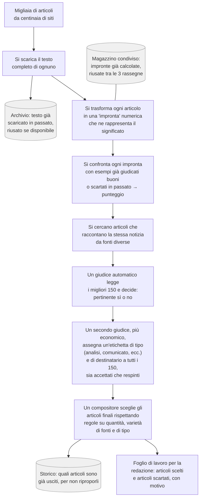

# Audit completo — 2026-08-22

Solo lettura. Nessun file di pipeline modificato, nessuna chiamata a pagamento. Ogni affermazione
qui sotto è verificata leggendo il codice/i dati attuali in questa sessione, non ricostruita da
memoria delle sessioni precedenti — dove riuso un risultato già trovato prima lo dico esplicitamente.

---

## Parte 1 — Verifica di sostanza

### I 3 casi già noti (per contesto, non ri-derivati qui)
1. AUC di gpt-5.4 in `Confronto_kNN_vs_LLM.xlsx` calcolata contro il Sì/No dello stesso gpt-5.4 (quasi tautologica).
2. Accuratezza 84% in `Book-2_ct_eval.docx`: modello quasi certamente diverso da quello di produzione (gpt-5.4-nano via `AZURE_OPENAI_DEPLOYMENT`, non gpt-5.4), scelta forzata senza non_classificato, ground truth mai confermato come revisionato da una persona.
3. `PROD_COST` in `llm_only_rank.py`: commento dichiara "letto dai log reali", nessun log esiste nel repo.

### Nuovi casi trovati in questo audit

**4. Colori dei cluster che si ripetono su cluster diversi — bug verificabile, non ipotetico.**
`CLUSTER_COLORS` in tutti e 3 i `07_export_excel.py` ha **8 colori**; il colore assegnato è
`CLUSTER_COLORS[cluster_id % 8]`. Il run reale del 21/08 su Startup Thinking ha prodotto **153
cluster**. Dal cluster 9 in poi i colori si ripetono su cluster completamente scollegati — il
foglio dice esplicitamente "Titolo colorato: sospetto duplicato... stesso colore = stesso
cluster", ma quell'invariante si rompe oltre 8 cluster. Un revisore umano può leggere due notizie
non correlate come se fossero la stessa, o viceversa perdere fiducia nel segnale.

**5. La cache del testo intero non è mai stata davvero migrata — verificato sul codice che gira oggi.**
Tutti e 3 i `06_rank.py` leggono `models/corpus_fulltext_cache.json`. Esiste, per tutte e 3 le
pipeline, un secondo file `corpus_fulltext_cache.migrated.json` con chiavi corrette (URL
canonicalizzato invece di titolo) — creato il 14/08 e **mai più toccato**, mentre il file "vecchio"
continua a crescere (Startup: 17,9MB, ultimo aggiornamento 21/08, lo stesso giorno del run
reale). Risultato verificato nel run del 21/08: **0 hit su cache, 1378 richieste di rete rifatte
da zero** — non un costo in denaro, ma tempo reale sprecato a ogni run da quando la migrazione è
stata fatta (14/08) senza aggiornare il puntatore nel codice.

**6. Il README di `ocx_relevance` si contraddice da solo — verificato riga per riga.**
Riga 3: *"Non tocca `../src` né la pipeline di produzione."* Ultime righe dello stesso file:
*"Le mie modifiche a `../src/embed_classify.py`, `pipeline.py`, `confidence.py`... sono ancora
lì."* Ho verificato che le modifiche sono reali: `embed_classify.py` contiene marcature `[MOD]`/
`[MOD-STEP2]`/`[MOD-NUOVA]` (upgrade del modello di embedding a text-embedding-3-large, guardia
sulla dimensione, unificazione della normalizzazione testo). Ho anche verificato **quanto è
esposta** `src/pipeline.py`: il percorso di default (`run_standard`, nessun flag) non chiama
`embed_classify.py` — usa solo `classify.py` (puro LLM). Le modifiche sono esercitate solo da
`--gate` e `--compare`, non dal default. Quindi: l'affermazione di isolamento è vera per l'uso di
default, falsa alla lettera, e il file stesso lo ammette senza che nessuno l'abbia mai risolto.

**7. La confidence del gate guida il ripescaggio del compositore, ma non è mai stata validata come segnale.**
`select_for_newsletter()` ordina il pool dei bocciati per `gate_confidence` crescente, assumendo
che una confidence bassa su un "No" significhi "bocciato per poco". Il test a costo zero
richiesto il 21/08 per verificare questa correlazione non è mai stato fatto — non esisteva nessun
dato di confidence persistito prima di quella stessa sessione. Da quando esiste (`gate_cost_log.jsonl`,
dal run del 21/08) nessuna verifica è stata fatta se una confidence più bassa corrisponde
davvero a decisioni più incerte/più spesso sbagliate. Il compositore usa un proxy mai controllato.

**8. Il rifiuto di gpt-5.4-mini per il gate si basa su UNA sola misura, non su un intervallo.**
gpt-5.4 è stato misurato 3 volte sugli stessi 150 articoli (accordo 78,0–82,0%, kappa
0,495–0,573) proprio per stabilire quanto rumore aspettarsi tra run identici. gpt-5.4-mini è
stato misurato **una sola volta** (kappa 0,384) e scartato perché sotto la soglia 0,45 — un
margine di 0,066, più piccolo dell'ampiezza di rumore già misurata per gpt-5.4 stesso (0,078).
Non so se un secondo run di mini darebbe un numero diverso. Per nano il margine di errore è
enorme (recall 35% contro un minimo storico dell'81%) e la conclusione regge comunque; per mini,
scartarlo su un singolo numero così vicino alla soglia è una decisione presa con meno rigore di
quello che si è preteso da gpt-5.4.

**9. Un parametro documentato come configurabile che nessun codice legge.**
Il README di `src/` (la pipeline generale) documenta `TAXONOMY_MACRO_THRESHOLD` come variabile
d'ambiente per la soglia dei macro topic. Cercato in tutto il repo: **zero occorrenze** fuori dal
README. Non è collegata a nessuna soglia realmente applicata nel codice.

**10. Il numero di riferimento "82,0% / kappa 0,573" non ha uno script/log che lo produca in questo repo.**
L'ho trattato come baseline per tutta la sessione. Ho rifatto la stessa misura 3 volte
(78,0–82,0%, kappa 0,495–0,573: il valore originale rientra nell'intervallo, quindi non lo
contraddico) ma non ho mai trovato — né cercato abbastanza a fondo prima d'ora — il file che
l'ha prodotto la prima volta. Se esiste solo come calcolo fatto altrove (Excel, a mano), va
saputo: significa che l'UNICA misura totalmente indipendente da questa sessione è anch'essa non
verificabile nel repo.

**11. Controllato per sospetto di circolarità, risultato: non è un problema.**
`recall_newsletter.py` (prototipo, già segnalato come tale in `INDEX.md`) misura la recall su
110 articoli editoriali usando un kNN allenato sui 50 articoli originali — popolazioni diverse
(50 dal corpus RSS etichettato a mano, 110 dalle newsletter realmente pubblicate), non la stessa
popolazione vista due volte. A differenza dei casi 1-3, qui la struttura del test è corretta;
resta comunque un numero di prototipo, non di produzione, come l'INDEX.md dichiara già.

**12. Il cluster anomalo di 47 articoli di The Register non era una rubrica ricorrente: era testo
estratto sbagliato — e non è isolato a una testata.** Nota aggiunta il 24/08, fuori dal giro di
verifiche del 22/08: l'interpretazione originale di questo cluster mono-testata (46-47 articoli,
sim_media 0,87) era "rubrica ricorrente con formato ripetuto". Verificato invece che
`fetch_fulltext` cattura il widget "MOST POPULAR" della pagina invece del corpo dell'articolo: 4
articoli su temi scollegati (multa AliExpress, anniversario Viking 1, chip Nvidia, Intel/Fortinet)
hanno testo **byte-identico** in cache; confermato anche dal vivo, scaricando una pagina reale, che
il riquadro "MOST POPULAR" esiste davvero e il corpo vero dell'articolo non compare nel testo
estratto. Sul totale del dominio (50 articoli), **47 condividono lo stesso testo**.

Lo stesso pattern — un elemento di pagina catturato al posto dell'articolo — è stato trovato su
altre 3 testate: **ft.com** (messaggio di paywall, 7/7 campionati), **bebeez.it** (widget "cerco
soci/investitori", un sottoinsieme di 6/45) e **cybersecitalia.it** (banner cookie, 2/20 campionati).
Non è un caso isolato: sono almeno 4 domini, 3 meccanismi di contaminazione diversi. Corretto con
due commit successivi a questo audit: un controllo per collisione di testo tra articoli della
stessa testata (declassa a fallback quando il testo di due articoli diversi coincide) e la pulizia
mirata delle 62 voci di cache confermate contaminate (rifetch al prossimo run).

Ricontrollati anche gli ALTRI cluster mono-testata di grandi dimensioni trovati nella stessa
analisi, con esito diverso caso per caso — la lezione è che "mono-testata + alta similarità" non
implica automaticamente né "rubrica legittima" né "bug": va verificato sul testo ogni volta, non
per analogia.
- **BeBeez, un cluster con lo stesso identico bug** (6 articoli — Corneliani, Stripe/PayPal,
  apertura fondo HAT SGR: argomenti scollegati): stesso meccanismo di The Register, un widget
  commerciale generico catturato al posto dell'articolo. Ripulito dalla cache insieme al caso
  Register.
- **BeBeez, un secondo cluster genuinamente legittimo** (5 articoli, annuncio del podcast
  quotidiano "BeBeez Headlines News di [giorno] [data]"): il testo (qui è il summary RSS, non
  testo estratto) è davvero un annuncio templato che cambia solo la data — è una rubrica
  ricorrente vera. La vecchia interpretazione era corretta per QUESTO cluster, non per l'altro:
  "BeBeez = digest quotidiano" mescolava i due.
- **Sifted, 2 cluster (7 articoli campionati) — problema nuovo, diverso dagli altri**: il testo
  estratto comincia come contenuto reale e coerente, poi degrada in testo che sembra
  cifrato/scramblato (non una lingua riconoscibile) — stesso pattern su tutti i 7 articoli
  controllati, punto di rottura diverso ogni volta. Non è lo stesso bug delle altre testate: non
  c'è testo condiviso tra articoli (ogni articolo degrada in un modo diverso), per questo il
  controllo per doppioni incrociati usato sopra non lo intercetta. Nessuna ipotesi confermata sul
  meccanismo (possibile contromisura anti-scraping del sito). Non verificato se questo spieghi la
  clusterizzazione da solo o si sommi a una vicinanza tematica reale (Sifted è una testata
  verticale sulle startup europee, quindi una certa somiglianza tra articoli diversi è attesa
  anche senza bug). Richiede un'indagine dedicata, separata da questo audit — non ancora fatta.
- **Corriere della Sera, 4 cluster controllati (quiz, ondata di caldo, video del lupo, Ocean Film
  Festival) — tutti legittimi**: testo reale e coerente in ogni caso. Una rubrica quiz genuinamente
  ricorrente (domande diverse ogni volta), due coppie articolo+video della stessa notizia, due
  articoli reali sullo stesso tema (l'ondata di caldo) a pochi giorni di distanza. Nessuna
  contaminazione trovata.

Non fatto in questa nota: l'estrattore (`fetch_fulltext`/trafilatura) non è stato toccato, né è
stata indagata la causa della degradazione su Sifted — per scelta esplicita, prima si voleva sapere
quanto fosse esteso il problema, non correggerlo.

**13. Il reference set di Startup Thinking era contaminato dallo stesso bug — e il caso BeBeez è
l'esempio più chiaro di quanto la qualità dei dati conti più dell'ottimizzazione del modello.**
Nota aggiunta il 25/08. Il ranker "impara" per somiglianza: ogni articolo nuovo viene confrontato
con un insieme di 261 esempi già etichettati Sì/No (`reference_set.npz`). Controllato quell'insieme
con lo stesso criterio usato sul corpus (testo identico/quasi tra articoli diversi): **13 righe su
238 con testo pieno (5,5%) erano contaminate** dallo stesso widget/sidebar già trovato altrove — 3
di theregister.com e 2 di bebeez.it (entrambe testate, etichettate "No"), 8 di forbes.it (etichettate
**"Sì"** — trovate solo 2/8 dal controllo automatico, le altre 6 verificate a mano perché il blocco
"Trending" catturato cambia nel tempo e non sempre coincide tra un articolo e l'altro).

**Il caso BeBeez, per intero.** Nello stesso run analizzato al punto 12, sei articoli candidati con
lo stesso identico bug widget di BeBeez (Corneliani, Stripe/PayPal-53 mld, apertura fondo HAT SGR,
acquisizioni EGM, giri di poltrone, chiusura estiva BeBeez) erano finiti letteralmente **negli
ultimi posti dell'intero corpus: rank 1369-1377 su 1377**. La causa: il loro testo (il widget, non
l'articolo) coincideva quasi esattamente con 2 esempi di riferimento "No" **anch'essi contaminati
dallo stesso widget** — il ranker li leggeva come "confermato identico a un No", non per il loro
contenuto reale (mai letto da nessuno), ma per la somiglianza a un'etichetta sbagliata. Rimosse le 2
righe contaminate dal pool negativo e rigenerati i vettori (nessuna nuova chiamata API: rimuovere
righe non cambia gli embedding di quelle restanti), **gli stessi 6 articoli sono risaliti a rank
458-755** — dal fondo assoluto al centro del corpus, senza toccare una riga di codice del ranker,
solo correggendo l'etichetta di 2 esempi su 261.

Confronto sull'intero corpus dell'ultimo run (1377 articoli): 14 attraversano la soglia rank≤150
(il taglio del gate LLM) per il solo effetto della pulizia; spostamento medio 27 posizioni assolute.
I 14 articoli Sifted offuscati (punto 12) restano quasi tutti dove erano o salgono ulteriormente —
confermando che è un problema indipendente, non risolto da questa pulizia.

**Perché conta la direzione dell'etichetta.** Register/BeBeez erano contaminati nel pool **negativo**:
l'effetto (come visto sopra) è sotterrare candidati veri sotto un'etichetta sbagliata — un problema
di richiamo (falsi negativi). Forbes.it è contaminato nel pool **positivo**: un futuro candidato con
lo stesso tipo di blocco "Trending" guadagnerebbe punteggio per somiglianza a un "Sì" che in realtà
non è un giudizio editoriale — un problema di precisione (falsi positivi), il più dannoso dei due
perché è quello che fa entrare articoli sbagliati in rassegna, non quello che ne tiene fuori di buoni.

**Scoperta collegata: il pool inglese di Startup Thinking non viene mai usato.** `MIN_PER_CLASS = 10`
in `ranker.py` richiede almeno 10 esempi Sì e 10 No per lingua prima di usare il pool di quella
lingua; sotto soglia si ricade sull'italiano (`fallback_lang="it"`). Il pool inglese di Startup
Thinking ha solo **3 esempi Sì** (contro 70-73 No): sempre sotto soglia, sempre in fallback.
Verificato che **non è un problema di OCX o AI**: OCX ha pool inglese 77 Sì/11 No, AI 204 Sì/54 No,
entrambi usabili. La quota di articoli inglesi nel corpus è **~70% per tutte e 3 le pipeline**
(69,9-70,3%, verificato su `corpus_raw.jsonl` corrente) — per Startup Thinking questo significa che
circa 970 articoli su 1380 per run vengono oggi confrontati contro un pool di soli esempi italiani,
non per una scelta ma per la scarsità di esempi Sì inglesi nel set editoriale storico. Controllato se
le selezioni storiche già in `store/articles.jsonl` (161 articoli mai scesi sotto la soglia di
retention perché pubblicati) potessero rimediare senza bisogno di nuova etichettatura: **solo 3 sono
in inglese** (tech.eu, forbes.com, nif.fund) — le stesse 3 già nel reference set, nessuna riserva
nascosta. La causa è strutturale: le selezioni editoriali storiche (i positivi) sono quasi tutte
italiane, il mining automatico dei negativi (`origin: llm_judged`) è in maggioranza inglese — i due
lati del reference set sono stati costruiti da processi diversi, con uno sbilanciamento linguistico
opposto. Non richiede una correzione di codice (non toccati `MIN_PER_CLASS` né il fallback, per
scelta esplicita): richiede più esempi Sì in inglese, che oggi non esistono in numero sufficiente da
nessuna parte nel repository.

**14. Il declassamento incondizionato per dominio (punto 12) è stato ristretto dopo aver misurato
il suo costo collaterale — e forbes.it resta un buco accettato, non risolto.** Nota aggiunta il
25/08. La prima versione di `config/known_bad_domains.json` declassava a fallback TUTTO il testo
di 6 domini, inclusi bebeez.it e cybersecitalia.it, dove la contaminazione reale misurata era
parziale (6/45 e 2/20 pagine, non tutte — vedi punto 12). Verificato l'effetto su un confronto
ranking prima/dopo su tutte e 3 le pipeline: **un articolo vero e genuino di cybersecitalia.it**
("AI, presto un vertice bilaterale tra Usa e Cina?", testo reale confermato leggendo la cache: *"Secondo
la Reuters le due potenze potrebbero presto organizzare un incontro sull'AI..."*) **era rank 1 su
tutto il corpus AI prima di essere declassato** al solo sommario RSS per il fatto di venire da un
dominio in lista — non per una contaminazione reale sua. Il declassamento incondizionato, su un
dominio a contaminazione parziale, costa articoli buoni insieme a quelli cattivi.

Corretto distinguendo due categorie nel campo `estensione`: **sempre** (theregister.com, ft.com,
sifted.eu — tutte le pagine compromesse, o già gestito da un controllo dedicato) mantiene il
declassamento incondizionato; **parziale** (bebeez.it, cybersecitalia.it, forbes.it) non viene più
declassato in blocco, resta scoperto solo dal controllo per collisione (che li aveva trovati la
prima volta e continua a intercettare casi nuovi, senza mai toccare un articolo buono).

Conseguenza esplicita e accettata: **forbes.it resta con un buco di rilevamento**. Confermato 8/8
contaminato a mano (punto 12), ma il controllo per collisione ne intercetta solo 2/8 — la lista
"Trending" catturata cambia nel tempo, quindi la maggior parte delle coppie non supera la soglia di
somiglianza pur essendo ugualmente contaminate. Due tentativi di rilevatore generico per questo
schema (elenco di titoli scollegati) hanno già fallito su dati reali (punto 12): il problema è
semantico, non sintattico, e non si è trovata una regola economica che lo risolva senza generare
falsi positivi. Scelta esplicita: lasciare il buco scoperto piuttosto che costruire una regola che
costerebbe più di quanto valga — coerente con l'evidenza del caso cybersecitalia.it sopra.

### Valori hardcoded che dovrebbero essere in configurazione (o viceversa)
- `CLUSTER_SIM_THRESHOLD = 0.72`, `MIN_PER_CLASS = 10` (`ranker.py`) — costanti Python, un cambio richiede una modifica di codice, non di configurazione.
- `MAX_AGE_DAYS = 30`, `MAX_PER_FEED = 50` (`corpus/fetch_corpus.py`) — idem.
- `ARTICLES_RETENTION_DAYS = 365`, `EMBEDDINGS_RETENTION_DAYS = 60` (`common.py`) — idem.
- **6000 caratteri** (taglio del testo intero) è duplicato in 4 posti: inline in ciascuno dei 3 `05_llm_gate.py` e come costante nominata `BODY_MAX_CHARS` in `tag_articles.py`. Nessuna fonte unica: se uno dei 4 cambia, gli altri 3 no, senza errore visibile.
- `CONF_THRESHOLD`/`ACCURACY_GATE` (`src/confidence.py`) usano `os.getenv(...)` — un pattern diverso (variabili d'ambiente) da tutto il resto del progetto, che o è hardcoded in Python o vive nei nuovi file `config/*.json`. Tre convenzioni diverse nello stesso repo per lo stesso tipo di problema.
- Per contrasto, un caso fatto bene: `config/composer_ai.json` dichiara esplicitamente "max_per_testata NON misurato per AI specificamente... riusa lo stesso default" — è l'esempio di come le altre costanti sopra dovrebbero essere documentate, se non spostate in config.

### Codice scritto e mai eseguito (in questo checkout)
- L'intera catena `src/train_classifiers.py` → `retrain.py` → `compare_taxonomy.py`: nessun `.pkl` in `models/`, nessuno store `rlhf` su disco, `compare_taxonomy.py` richiede un `output/results_*.csv` che non esiste. Confermato di nuovo in questo audit (stessa conclusione del 20/08, non cambiata).

### Funzioni duplicate tra le 3 pipeline — divergenza reale vs innocua
- **Reale, già nota**: `05_llm_gate.py` — OCX carica la descrizione da `config/osservatori.json` dinamicamente, AI e Startup la hardcodano come stringa. Se `osservatori.json` cambia, solo OCX se ne accorge.
- **Controllata e trovata identica**: `MIN_NEGATIVI`/`N_BORDERLINE_EXTRA` in `08_build_review_sheet.py` (30/30 in tutte e 3), `ranker.py` (file unico condiviso, non tre copie — nessun rischio di divergenza).

---

## Parte 2 — Persistenza e formato dei dati

| File | Formato | Scrive | Legge | Sovrascritto/accumula | Se manca |
|---|---|---|---|---|---|
| `corpus/corpus_raw.jsonl` | JSONL | `fetch_corpus.py` | `06_rank.py` ×3 | **Sovrascritto** (default; `--out` per evitarlo) | Il ranking non parte — nessun fallback |
| `corpus/feeds.yaml` | YAML | manuale | `fetch_corpus.py` | manuale | Fetch di 0 feed |
| `corpus/tracking_params.yaml` | YAML | manuale | `canonicalize_url` (tutte le pipeline) | manuale | Canonicalizzazione degrada silenziosamente (nessuno strip parametri) |
| `corpus/*_stats.json`, `*_feed_report.json` | JSON | `fetch_corpus.py` | **nessuno** | sovrascritto (nome derivato da `--out`) | Solo diagnostica persa, nessun effetto funzionale |
| `config/*.json` (taxonomy, editorial_groups, composer_*, models, osservatori) | JSON | manuale | vari moduli, per file | manuale | Eccezione a runtime (file mancante) — nessun default in codice |
| `store/articles.jsonl` | JSONL | `upsert_articles_store()` (`06_rank.py` step 7, backfill) | `09_compose.py`, `embed_texts_cached` (esenzione retention) | **Accumula** (read-merge-write), **scrittura NON atomica** (`open(..., "w")` diretto) | Store vuoto: si riparte da zero, si perdono 2150 righe (773 storiche + 1377 da run reali) senza modo di ricostruire le 1377 |
| `store/embeddings.npz` | npz binario | `embed_texts_cached()` | stesso modulo, tutte le pipeline | **Accumula**, **scrittura NON atomica** (`np.savez_compressed` diretto) | Perdita totale: embedding reali già pagati (~1400+ articoli), da ripagare per intero se corrotto senza backup |
| `<oss>/data/dataset.jsonl` + `dataset_meta.json` | JSONL+JSON | `02_build_dataset.py` / backfill | `04_valuta.py`, `06_rank.py` (esclusione self-match) | Sovrascritto | Reference set perso: il ranker non ha esempi |
| `<oss>/models/dataset_vectors.npz`, `reference_set.npz` | npz | `03_embed.py`, `04_valuta.py` | `06_rank.py` step 3 | Sovrascritto | Ranking impossibile, richiede re-embedding a pagamento |
| `<oss>/models/corpus_fulltext_cache.json` | JSON | `06_rank.py` step 1 | stesso | **Accumula ma con chiave sbagliata** (vedi Parte 1 #5), scrittura non atomica | Solo testo da riscaricare (gratis, lento) |
| `<oss>/models/corpus_fulltext_cache.migrated.json` | JSON | nessuno (snapshot del 14/08) | **nessuno** | file orfano | Nessun effetto — non è mai letto |
| `<oss>/data/dedup_stats.json` | JSON | `06_rank.py` (load_corpus + dedup) | nessuno | sovrascritto a ogni run (accumula solo dentro un run) | Solo diagnostica |
| `<oss>/data/cluster_metadata.json` | JSON | `06_rank.py` step 4b | nessuno script (solo lettura umana) | Sovrascritto | Solo diagnostica per revisione manuale |
| `<oss>/data/ranking.csv` | CSV | `06_rank.py` step 6 | `07_export_excel.py`, `08_build_review_sheet.py`, `09_compose.py` | **Sovrascritto** | Compositore ed export non hanno nulla da leggere |
| `<oss>/data/gate_cost_log.jsonl`, `tag_cost_log.jsonl` | JSONL | `log_gate_cost`/`log_tag_cost` | nessuno (solo analisi manuale) | **Accumula per sempre**, nessuna rotazione | Solo perdita di uno storico costi |
| `<oss>/data/composizione.xlsx` | XLSX | `09_compose.py` | nessuno | Sovrascritto | Nessuna newsletter proposta da revisionare |
| `LABEL-Newsletter.xlsx` e equivalenti | XLSX | `07_export_excel.py`, `08_build_review_sheet.py` (nuovo foglio) | nessuno script automatico | Aggiunge un foglio, non sovrascrive gli altri | Solo il foglio di revisione manca |

### Segnalazioni esplicite richieste

**File la cui perdita non è recuperabile**: `store/embeddings.npz` (peggiore: soldi reali già
spesi) e `store/articles.jsonl` (1377 righe di tracking da run reali, non ricostruibili — le 773
storiche sì, rifacendo il backfill). Entrambi scritti **senza pattern atomico** (niente
temp-file + rename): un crash a metà scrittura tronca il file esistente, non solo impedisce
l'aggiornamento.

**Dati calcolati e scartati senza essere salvati**: `content_type`/`target_audience` (vedi Parte
3 — non arrivano mai allo store, solo al `ranking.csv` che viene sovrascritto al run successivo).
`cluster_sim` (la matrice di similarità coseno dentro i cluster) viene usata per calcolare
`cluster_metadata.json` e poi scartata — ricostruibile rifacendo l'embedding+clustering (deterministico
a parità di embedding), ma non gratis in tempo.

**Due parti di codice che assumono formati diversi per lo stesso file, in pratica**: i due file
`corpus_fulltext_cache.json` / `corpus_fulltext_cache.migrated.json` sono, concettualmente, "la
stessa cache" a due stadi della sua evoluzione — chiave per titolo nell'uno, per URL
canonicalizzato nell'altro. Il codice ne legge uno, la migrazione ha prodotto l'altro: sono
disallineati de facto (Parte 1 #5).

---

## Parte 3 — Forma dei dati per stadio

| Stadio | Input | Output | Campi aggiunti | Prodotto e mai più usato |
|---|---|---|---|---|
| **Ingestione** | `feeds.yaml` (URL RSS) | riga per articolo: `title, link, published_date, summary, feed_name` | — | — |
| **Testo intero** | riga sopra + cache (chiave sbagliata, Parte 1) | stessa riga + `full_text`, `text_source` | `full_text`, `text_source` | — |
| **Dedup contenuto** | lista con `full_text` | lista filtrata (stesso schema) | nessuno sulla riga: `content_hash` calcolato ma **non attaccato** all'articolo, solo usato per il filtro e ricalcolato daccapo allo step 7 per lo store | `content_hash` di questo passaggio (ricalcolato dopo, non riusato) |
| **Embedding** | testi | matrice `X` (3072 dim), parallela agli articoli per indice | nessun campo sull'articolo — il vettore non è mai serializzato sul dict articolo, vive solo come riga di `X` | — |
| **Ranking (kNN)** | `X`, lingue, pool di riferimento | `scores`, `order` (array paralleli) | nessun campo sull'articolo | — |
| **Clustering** | `X`, soglia 0.72 | `cluster_id` e `cluster_peers` scritti su ogni articolo; `cluster_metadata.json` a parte | `cluster_id`, `cluster_peers` (sull'articolo, in memoria); persistito **solo** `cluster_id` (in `ranking.csv`) — `cluster_peers` esiste solo per la durata del run, serve al prompt del gate e poi si perde | `cluster_peers` dopo il run |
| **Gate** | `topn` (con `cluster_peers`) | `llm`, `llm_confidence`, `llm_motivo` sull'articolo | idem | — |
| **Tagging** | stesso `topn` | `content_type`, `target_audience` — **non riattaccati al dict articolo**, restano solo nelle mappe locali `content_type_map`/`audience_map` usate per scrivere il CSV | — | **Sì — il caso più rilevante**: questi due campi non toccano mai `store/articles.jsonl` (`_ARTICLE_FIELDS` non li include, verificato nel codice). Sono ricalcolati da zero a ogni run di `06_rank.py`, con un costo reale ogni volta, perché non esiste nessuna persistenza di lungo periodo per loro fuori da un `ranking.csv` che il run successivo sovrascrive |
| **Output CSV** | `arts` + tutte le mappe | una riga per l'intero corpus post-dedup (non solo `topn`) | colonne vuote per pertinenza/confidence/motivo/content_type/audience su chi non è arrivato al gate | — |
| **Store** | `arts` + `order` | record `{url_canonico, osservatorio, content_hash, published_date, text_source, last_rank, selected_for_newsletter}` | **conferma**: niente `content_type`/`target_audience`/`cluster_id` | (vedi sopra) |
| **Compositore** | `ranking.csv` (righe con `pertinenza_llm` non vuota) + store + config | `composizione.xlsx`, 2 fogli | `_via`, `_gruppo`, `motivo_esclusione` (solo nel file Excel, non tornano indietro nel CSV o nello store) | `_via`/`_gruppo`/`motivo_esclusione` esistono solo in quel file, non riusabili da nessun altro step |

---

## Parte 4 — Flusso dati, per non tecnici

**In parole povere, passo per passo:**

1. **Raccolta**: si guardano centinaia di siti di settore e si prendono gli articoli pubblicati di recente. Niente lettura del contenuto ancora, solo titolo e riassunto.
2. **Lettura completa**: per ogni articolo si scarica il testo vero e proprio dal sito, non solo l'anteprima — alcuni siti bloccano questo passaggio, e in quel caso ci si accontenta dell'anteprima.
3. **Impronta numerica**: un servizio esterno legge il testo e lo trasforma in una sequenza di numeri che ne cattura il significato — articoli che parlano di cose simili avranno impronte simili. Questo passaggio viene riusato tra le tre rassegne, perché molti articoli sono in comune.
4. **Punteggio per somiglianza**: si confronta l'impronta di ogni articolo nuovo con quella di esempi già valutati in passato (buoni e cattivi) e si assegna un punteggio — più simile a un buon esempio, punteggio più alto. Non c'è nessun addestramento: è un confronto diretto ogni volta.
5. **Ricerca doppioni**: si cercano gruppi di articoli che raccontano la stessa notizia, spesso perché la stessa agenzia di stampa viene ripresa da più testate — utile per non segnalare la stessa notizia più volte come se fossero notizie diverse.
6. **Giudizio di pertinenza**: i migliori 150 articoli per punteggio vengono letti da un modello linguistico che decide se sono davvero in tema con la rassegna, a prescindere dal punteggio calcolato prima.
7. **Etichettatura**: sugli stessi 150 (sia quelli approvati sia quelli respinti) un secondo modello, più economico, assegna un tipo di contenuto (es. analisi, comunicato aziendale, normativa) e un pubblico di riferimento (es. chi si occupa di marketing, chi di tecnologia).
8. **Composizione**: un ultimo passaggio automatico sceglie quali articoli entrano davvero nel numero, rispettando regole su quanti in totale, quanti dello stesso tipo, quanti dalla stessa fonte — e controllando di non riproporre qualcosa già pubblicato in passato.
9. **Consegna**: il risultato è un foglio di lavoro con gli articoli scelti e quelli scartati (motivo incluso), pronto per essere rivisto da una persona prima di diventare la newsletter vera e propria.

---

## Parte 5 — Numeri difendibili in una presentazione

| Numero | Fonte | Come misurato | Limite |
|---|---|---|---|
| **46,8%** delle selezioni storiche da fonti mai tracciate | analisi sessioni precedenti su 773 selezioni storiche | conteggio diretto, dominio per dominio | Solo OCX/AI/Startup — `Fonti news (5).xlsx` (altri osservatori) mai incluso |
| **Precision@10/20 = 80%/75%** kNN vs giudizio umano (Startup) | ricalcolato dai dati reali (`Da_revisionare`) | 150 articoli etichettati da un ricercatore | Solo Startup Thinking, un solo giudice umano |
| **AUC = 0,778** kNN vs giudizio umano | calcolato in questa sessione (mai fatto prima) | `roc_auc_score` su 150 etichette reali | Stesso campione di cui sopra |
| **Tau: kNN 0,36 / gpt-5.4 0,47 / sol 0,43 / luna 0,43** vs giudizio umano | ricalcolato su dati reali | Kendall tau, n=148-149 | Copertura bassa nei top-10/20 (2-5 articoli etichettati su 10) |
| **Accordo gate 78,0–82,0%, kappa 0,495–0,573** (gpt-5.4, 3 misure) | 3 run reali identici | stessi 150 articoli, 3 volte | Il valore "82,0%/0,573" originale non ha uno script trovato in questo repo (Parte 1 #10) |
| **Recall gate: nano 35,1%, mini 97,3%, gpt-5.4 81-87%** | 1 run ciascuno (nano, mini), 3 run (gpt-5.4) | stessi 150 articoli | mini a un solo run, margine dalla soglia più piccolo del rumore noto (Parte 1 #8) |
| **Content type storico**: OCX analysis 77%, Startup vendor_announcement 45%, AI analysis 55% | tagging reale il 21/08 | gpt-5.4 su titolo+riassunto, 107/161/150(campione) articoli storici | AI su campione 150/500, non tutto; metodo diverso dal tagging live (riassunto, non testo intero) |
| **84% accuratezza CT few-shot** | `Book-2_ct_eval.docx`, 26/06 | 50 articoli | Modello quasi certamente diverso da produzione, ground truth non confermato umano (Parte 1 #2) |
| **Costo gate €0,73-0,81/pipeline, tagging nano €0,04-0,09/pipeline** | log reali del run 21/08 | misurato da `gate_cost_log.jsonl`/`tag_cost_log.jsonl` | Solo Startup Thinking eseguita end-to-end; OCX/AI proiettati, non misurati con la stessa pipeline aggiornata |
| **Prezzi mini/nano** (0,50/3,00 e 0,125/0,75 €/milione) | stima per analogia con gpt-4.1 | nessuna misura reale | **Non confermato da Azure** — va ripetuto ad ogni citazione (già in `config/models.json`) |
| **Proiezione 60 osservatori** (~€17-320/mese secondo il modello) | calcolo derivato | moltiplica il costo per pipeline ×20 | Eredita l'incertezza dei prezzi mini/nano; assume che tutti i 60 osservatori si comportino come le 3 pipeline misurate |
| **153 cluster, 8 colori** | contato sul run reale del 21/08 | diretto da `cluster_metadata.json` | — |
| **0% hit sulla cache testo intero** | contato sul run reale del 21/08 | log dello stesso run | Specifico di questo run/pipeline, ma il bug è strutturale (Parte 1 #5), non un caso isolato |

**Numeri NON da citare senza il loro difetto attaccato**: l'AUC di gpt-5.4 contro se stesso, l'84%
di `Book-2_ct_eval.docx`, qualunque cifra di `PROD_COST` presentata come "dai log di produzione".
